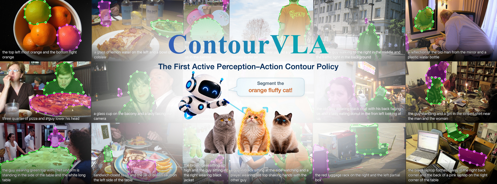

<h1>&nbsp;ContourVLA</h1>

<h2>Contour Evolution for Referring-Expression Segmentation</h2>

  
  &nbsp;&nbsp;
  

  Ruicheng Zhang1,2,*&nbsp;&nbsp;
  Kaiwen Shen1,*&nbsp;&nbsp;
  Jiaqi Hou2,*&nbsp;&nbsp;
  Shuhan Yang2&nbsp;&nbsp;
  Junchao Huang4 
  <strong>Kewei Zhang</strong>3&nbsp;&nbsp;
  <strong>Jun Zhou</strong>2&nbsp;&nbsp;
  <strong>Li Jiang</strong>4&nbsp;&nbsp;
  <strong>Shen Zhao</strong>1,&dagger;

  1Sun Yat-sen University &nbsp;&nbsp;
  2Tsinghua University &nbsp;&nbsp;
  3Peking University 
  4The Chinese University of Hong Kong, Shenzhen

  <em>* Equal contribution &nbsp;&nbsp; &dagger; Corresponding author</em>

  <a href="INSTALL.md">Install</a> &nbsp;|&nbsp;
  <a href="DATASETS.md">Datasets</a> &nbsp;|&nbsp;
  <a href="#inference-on-the-bundled-examples">Quick demo</a> &nbsp;|&nbsp;
  <a href="#evaluation">Evaluation</a>

  

## Overview

Generalized referring expression segmentation (GRES) requires dynamically balancing high-level semantics for identifying a variable number of language-specified referents with fine-grained visual evidence for precise boundary delineation. This requirement challenges existing cascaded vision-language architectures, which typically rely on static feature interfaces and single-pass mask prediction, limiting adaptive perception and geometric correction. We introduce ContourVLA, a vision-language-action policy that recasts GRES as a closed-loop visuomotor process, in which editable contours serve as explicit policy states that condition multimodal perception and are updated by geometric action chunks. Evolution-Aware Semantic Scheduling (EASS) couples contour-guided bidirectional boundary sampling with state-conditioned routing of multilevel multimodal features, adapting perception to each contour state. Following supervised initialization, Dustbin-Augmented Entropic Credit Transport GRPO (DECT-GRPO) jointly optimizes discrete grounding and continuous contour actions with instance-level credits. Its rollout rewards and credits are derived from soft prediction-target correspondences that account for false positives and missed targets. ContourVLA improves gIoU over the strongest evaluated baselines by 8.7, 2.8, and 2.7 points on gRefCOCO val, testA, and testB, respectively, and achieves the highest mIoU across all eight RefCOCO, RefCOCO+, and RefCOCOg splits.

## Repository contents

| Path | Purpose |
| --- | --- |
| <code>contourvla/</code> | Model, contour geometry, data, training, and RL modules |
| <code>configs/sft.yaml</code> | Stage A SFT configuration |
| <code>configs/rl.yaml</code> | Stage B RL configuration |
| <code>scripts/demo_examples.py</code> | Inference on the eight bundled examples |
| <code>scripts/evaluate.py</code> | Tracking metrics and visualization |
| <code>scripts/evaluate_gres.py</code> | Official GRES-style metrics |
| <code>asset/</code> | Cover image, example images, and manifest |
| <code>ckpts/contourvla.pt</code> | Inference checkpoint, downloaded separately |

## Requirements

- Linux with Python 3.10 or newer.
- The versions listed in <code>requirements.txt</code>. PyTorch and torchvision should match the installed CUDA runtime.

~~~bash
python3 -m venv .venv
source .venv/bin/activate
python -m pip install --upgrade pip
python -m pip install -r requirements.txt
export PYTHONPATH="$PWD"
~~~

See [INSTALL.md](INSTALL.md) for the short setup checklist.

Download the checkpoint and place it at <code>ckpts/contourvla.pt</code>:

~~~bash
huggingface-cli download Richard-ZZZZZ/ContourVLA contourvla.pt --local-dir ckpts
~~~

## Data and runtime layout

Download gRefCOCO and COCO as described in [DATASETS.md](DATASETS.md), then use this layout:

~~~text
data/grefcoco/grefs(unc).json    # referring expressions
data/grefcoco/instances.json     # COCO-style annotations
data/coco/images/train2014/      # COCO train2014 images
~~~

## Training

Edit <code>data.root</code> before launching a run.

### Stage A: supervised fine-tuning

~~~bash
PYTHON=python NPROC=8 CONFIG=configs/sft.yaml \
  bash scripts/launch_train.sh
~~~

For a short configuration check:

~~~bash
PYTHON=python NPROC=1 CONFIG=configs/sft.yaml \
  bash scripts/launch_train.sh --set train.max_steps=20 train.eval_every=20
~~~

### Stage B: RL post-training

The default RL config starts from <code>outputs/stage_sft/best.pt</code>:

~~~bash
python -m torch.distributed.run --standalone --nproc_per_node=8 \
  scripts/train_rl.py --config configs/rl.yaml
~~~

The default output directories are <code>outputs/stage_sft</code> and <code>outputs/stage_rl</code>. Override scalar settings with one or more <code>--set section.key=value</code> arguments.

## Inference on the bundled examples

Run the released checkpoint on all eight images:

~~~bash
PYTHONPATH=. python scripts/demo_examples.py \
  --config configs/rl.yaml \
  --checkpoint ckpts/contourvla.pt \
  --manifest asset/examples.json \
  --output outputs/examples
~~~

The command writes overlay panels to <code>outputs/examples/step*_example_*.jpg</code> and a JSON record to <code>outputs/examples/results.json</code>. It does not need the full annotation files because the manifest contains the image and expression pairs.

For a single custom image:

~~~python
from PIL import Image
from contourvla.config import ContourVLAConfig
from contourvla.models.contourvla import ContourVLA

config = ContourVLAConfig.load("configs/rl.yaml")
model = ContourVLA(config).eval()
result = model.predict(Image.open("image.jpg").convert("RGB"), "the object on the left")
print(result["boxes"], result["contours"])
~~~

## Evaluation

Tracking evaluation on a split:

~~~bash
python scripts/evaluate.py \
  --config configs/rl.yaml \
  --checkpoint outputs/stage_rl/best.pt \
  --split val --max-samples 200
~~~

Official GRES metrics at annotation resolution:

~~~bash
python scripts/evaluate_gres.py \
  --config configs/rl.yaml \
  --checkpoint outputs/stage_rl/best.pt \
  --split val --max-samples 0
~~~

Use <code>--split testA</code> or <code>--split testB</code> for held-out gRefCOCO partitions. <code>scripts/run_gres_eval.sh</code> is a convenience wrapper for sharded multi-GPU evaluation.

## Citation

~~~bibtex
@article{zhang2026contourvla,
  title={ContourVLA: A Closed-Loop Perception-Action Contour Policy for Generalized Referring Expression Segmentation},
  author={Zhang, Ruicheng and Shen, Kaiwen and Hou, Jiaqi and Yang, Shuhan and Huang, Junchao and Zhang, Kewei and Zhou, Jun and Jiang, Li and Zhao, Shen},
  journal={arXiv preprint arXiv:2610.12107},
  year={2026}
}
~~~

## License

Code is released under the license in [LICENSE](LICENSE). COCO, gRefCOCO, and the example images retain their original licenses and terms.
